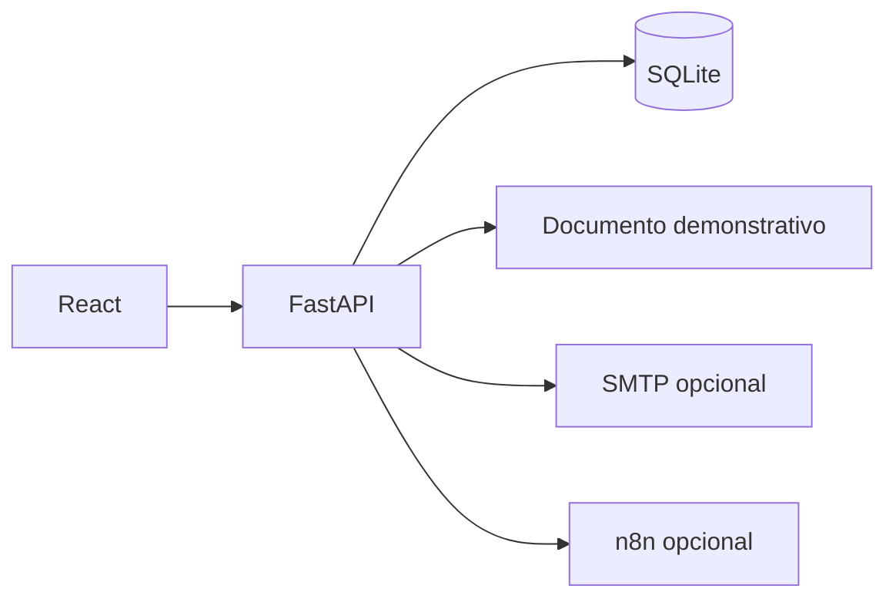

# NexoFiscal

## 1. Apresentação

Protótipo de emissão simulada de documentos de serviços com revisão no servidor e histórico.

## 2. Problema empresarial

Conduzir cadastro, revisão e acompanhamento de documentos de serviços em uma jornada organizada.

## 3. Objetivo

Demonstrar regras de validação, permissões, idempotência e rastreabilidade sem integração fiscal oficial.

## 4. Funcionalidades implementadas

- Clientes PF/PJ, serviços e revisão de dados.
- Emissão, rejeição e cancelamento simulados; PDF, HTML e XML demonstrativos.
- Perfis de acesso, histórico e financeiro de apoio.
- Preparação de e-mail e transporte SMTP manual opcional; integração n8n opcional.

As funcionalidades foram identificadas nos módulos e na documentação originais. Os resultados de verificação desta cópia estão em [Validação](docs/github/VALIDACAO.md); não se alegam ganhos de negócio ou métricas de produção.

## 5. Tecnologias

Python 3.13, FastAPI, Pydantic, SQLAlchemy, Alembic, SQLite, React/JSX, Vite, ReportLab e qrcode. Há configuração de PostgreSQL/Compose, sem homologação de execução declarada.

Os manifests originais foram preservados. Nenhuma dependência nova foi adicionada à aplicação para esta apresentação.

## 6. Arquitetura



[Arquitetura e limites da cópia](docs/github/ARQUITETURA.md).

## 7. Estrutura de pastas

```text
backend/         API, migrations e testes
frontend/        interface React
infrastructure/  preparação e execução local
windows_demo/    iniciador Windows
n8n/             integração opcional
docs/            API, arquitetura e demonstração
```

Ambientes instalados, caches, bancos operacionais, configurações privadas e compilados ficam fora do pacote fonte. [Critérios de seleção](docs/github/SEGURANCA.md).

## 8. Instalação

Na raiz de uma cópia nova, com Python 3.13 e Node.js 22, crie a configuração local:

```powershell
Copy-Item .env.example .env
```

Antes do setup, preencha **DEMO_ADMIN_PASSWORD** com uma senha própria de ao menos 8 caracteres e **PORTFOLIO_PASSWORD** com outra de ao menos 12 caracteres no .env local. Esses campos foram deixados vazios de propósito no exemplo. O setup gera DEMO_PASSWORD quando esse campo está vazio, mas não gera as outras duas senhas. Mantenha SMTP e integrações privadas vazios. Depois execute:

```powershell
powershell.exe -NoProfile -ExecutionPolicy Bypass -File .\infrastructure\setup-local.ps1 -Portfolio
```

O assistente instala os requisitos existentes, prepara configuração e provisiona a demonstração. Não execute em uma pasta de operação com dados reais.

## 9. Configuração do ambiente

Campos privados de SMTP, tokens, chaves e senhas não acompanham esta cópia; os campos de credencial em .env.example ficam vazios. O setup possui seu próprio provisionamento local. Não configure SMTP ou n8n para a primeira avaliação. Nunca copie bancos, backups, .env ou diretório .runtime da instalação do autor.

## 10. Como executar

Execute **Iniciar NexoFiscal.cmd** na cópia preparada e abra http://127.0.0.1:5180. A API fica em http://127.0.0.1:8010/docs. Use **Entrar no portfólio**.

Todos os documentos são demonstrativos, com indicação de ausência de validade fiscal. Nenhuma transmissão à prefeitura é implementada. O transporte SMTP, se alguém o configurar e confirmar, pode enviar mensagens reais; permaneceu sem configuração real nesta revisão.

Os comandos desta documentação se destinam a uma cópia preparada pelo leitor; não foram usados para iniciar a operação do autor nesta etapa.

## 11. Como testar

Na pasta backend, com seu ambiente preparado:

```powershell
.\.venv\Scripts\python.exe -m pytest -q
```

Na raiz:

```powershell
npm.cmd --prefix frontend run build
```

As fixtures configuram banco separado, SMTP vazio e testes de e-mail com transportes simulados. Nenhum documento real ou envio externo deve ser usado como teste.

[Resultados e limitações da verificação desta preparação](docs/github/VALIDACAO.md).

## 12. Capturas e demonstrações reais

[Veja as telas e demonstrações já existentes no portfólio](https://leandroaugferreira.github.io/nexofiscal.html). Não foram criadas imagens fictícias nem alteradas as mídias do projeto.

## 13. Limitações conhecidas

Não emite NFS-e válida, não calcula/apura tributos oficiais e não integra autorização governamental. PostgreSQL/Compose não foram novamente homologados. Envio SMTP real e n8n precisam de avaliação e autorização próprias. Não foram copiados bancos, documentos ou destinatários operacionais.

## 14. Estado atual

Código-fonte disponibilizado pelo autor para demonstração e avaliação técnica. As evidências locais de 02/11/2026 estão em docs/github/VALIDACAO.md.

A escolha de licença depende da aprovação do autor; nenhuma licença nova foi atribuída.

[API](docs/api.md) · [Arquitetura](docs/arquitetura.md) · [Escopo fiscal](docs/fiscal.md)

## 15. Portfólio

[NexoFiscal no portfólio](https://leandroaugferreira.github.io/nexofiscal.html) · [Portfólio completo](https://leandroaugferreira.github.io/).
