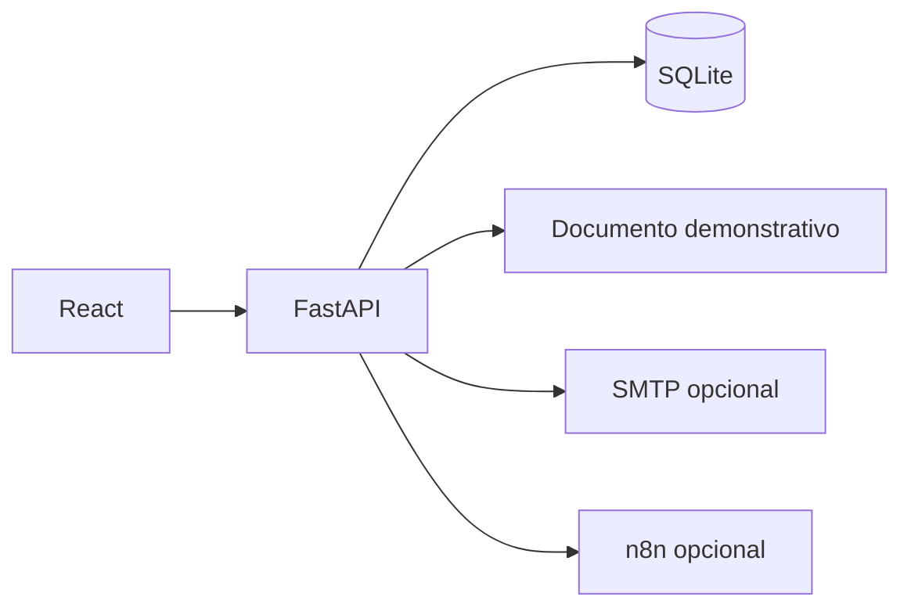

# Arquitetura observada

Python 3.13, FastAPI, Pydantic, SQLAlchemy, Alembic, SQLite, React/JSX, Vite, ReportLab e qrcode. Há configuração de PostgreSQL/Compose, sem homologação de execução declarada.

Não emite NFS-e válida, não calcula/apura tributos oficiais e não integra autorização governamental. PostgreSQL/Compose não foram novamente homologados. Envio SMTP real e n8n precisam de avaliação e autorização próprias. Não foram copiados bancos, documentos ou destinatários operacionais.

O diagrama resume relações encontradas no código; não representa uma implantação em produção. Serviços externos opcionais não foram ativados nesta preparação.
